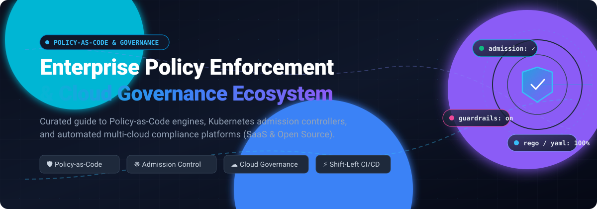

<div align="center">



# 🛡️ Awesome Enterprise Policy Enforcement &amp; Governance

<a href="https://github.com/ishandutta2007/Awesome-Awesome-Awesome"></a><a href="https://discord.gg/jc4xtF58Ve"></a>
[](https://github.com/ishandutta2007/Awesome-Awesome-Awesome)
[](https://opensource.org/licenses/MIT)
[](http://makeapullrequest.com)
<a href="https://github.com/ishandutta2007"></a>

**A curated index of production-grade Policy Enforcement engines, Policy-as-Code (PaC) frameworks, Kubernetes admission controllers, and Cloud Governance platforms across commercial SaaS and open-source ecosystems.** 🚀

</div>

---

Policy-as-Code (PaC) and automated cloud governance enable organizations to codify compliance, security guardrails, access control, and operational best practices into version-controlled, automated, and testable definitions. Rather than relying on periodic manual audits, these platforms shift compliance left and enforce runtime safeguards across multi-cloud environments, Kubernetes clusters, and Infrastructure-as-Code (IaC) pipelines. 🔒✨

---

## 📑 Table of Contents

- [📊 Sector Overview & Market Dynamics](#-sector-overview--market-dynamics)
- [💼 SaaS & Commercial Hosted Platforms](#-saas--commercial-hosted-platforms)
- [🔓 Open-Source GitHub Projects](#-open-source-github-projects)
- [🏛️ Key Architectural Paradigms](#️-key-architectural-paradigms)
- [🤝 Contributing](#-contributing)
- [💖 Support](#-support)
- [⭐ Star History](#-star-history)
- [⚠️ Disclaimer](#️-disclaimer)

---

## 📊 Sector Overview & Market Dynamics

The dedicated Policy-as-Code (PaC) management platform market is currently valued at approximately **$1.7B to $2.0B**, with adjacent Cloud Governance and Compliance software markets reaching upwards of **$5.7B** and projected to surpass **$18B+ by 2033** at an annual growth rate (CAGR) exceeding 19%. 📈

The sector remains **moderately fragmented**: high-level cloud security posture and runtime enforcement are increasingly consolidated by multi-billion-dollar cybersecurity and cloud conglomerates (such as Palo Alto Networks and IBM/HashiCorp), yet core policy evaluation engines and admission controllers remain decentralized and driven by open-source standards (such as CNCF's Open Policy Agent and Kyverno) alongside domain-specific SaaS specialists for API and developer governance. 🌐

---

## 💼 SaaS & Commercial Hosted Platforms

The table below catalogs premier commercial SaaS and managed platforms for enterprise policy enforcement and cloud governance, ranked in descending order by company scale (market capitalization, acquisition valuation, or company valuation). 🏢

| Product | Company Size (Valuation / Revenue) | Description | Starting Pricing | Free Tier / Trial Limits |
| :--- | :--- | :--- | :--- | :--- |
| **[Prisma Cloud (Palo Alto Networks)](https://www.paloaltonetworks.com/prisma/cloud)** | **~$265B Market Cap** (Public: NASDAQ: PANW; ~$8B+ Ann. Revenue) | Comprehensive enterprise CNAPP featuring Infrastructure-as-Code (IaC) scanning, Cloud Security Posture Management (CSPM), and run-time policy guardrails (powered by Checkov/Bridgecrew tech). | **~$30,000/year** entry-level baseline; billed via consumption-based credit pools (minimum 100-credit tiers) | **30-day free trial** available directly via Palo Alto Networks; 15-day free trials provisioned on AWS/Azure Marketplace with resource/module limits |
| **[HashiCorp Sentinel (IBM)](https://www.hashicorp.com/sentinel)** | **$6.4B Valuation** (Acquired by IBM; ~$650M+ ARR) | Embedded policy-as-code framework integrated across HCP Terraform and enterprise cloud products, supporting fine-grained operational logic, cost enforcement, and VCS-integrated policy checks. | **$0.47 per managed resource/month** (Standard / Plus tier baseline required to unlock Sentinel; Essentials does not include Sentinel) | **Free tier available forever** on HCP Terraform for up to **500 managed resources** (Sentinel policies require Standard+ tier upgrade or a structured 30-day trial) |
| **[Postman Enterprise Governance](https://www.postman.com/)** | **$5.6B Valuation** (Series D; ~$313M ARR) | API governance, schema validation, and security rule enforcement across enterprise engineering teams via centralized API catalogs, spectral linting, and workspace rules. | **$800 per user/month** (Enterprise tier billed annually; team tier starts at **$15/user/month**) | **30-day free trial** for Enterprise features; free-for-ever plan includes up to **3 team members** and 25 API requests/month for basic collections |
| **[Styra DAS](https://www.styra.com/)** | **~$150M–$250M Valuation** (~$54M–$67.5M Raised; ~$10M–$15M ARR) | Commercial control plane and policy lifecycle management platform for Open Policy Agent (OPA). Provides centralized decision audit logging, policy testing, and compliance reporting across Kubernetes and cloud services. | **$1,000/month** starting tier (self-hosted / standard production); enterprise custom scale starts upwards of **$5,000/month** on AWS Marketplace | **Free-for-ever plan** supports up to **2 systems, 5 OPA instances, and 20 policies**; custom enterprise PoC trials available upon request |
| **[42Crunch](https://42crunch.com/)** | **~$60M–$80M Valuation** ($20.6M Total Funding; Series A) | Developer-first API security and policy governance platform offering automated OpenAPI/Swagger contract security audits, vulnerability scanning, and API firewall enforcement. | **$375/month** ($4,125 billed annually) for Starter tier (up to 5 users and 75 API endpoints); Growth starts at **$1,150/month** | **Free-for-ever plan** includes 1 user with **100 operations/month** each for Contract Generator, Security Audit, and Security Scan (IDE-only extension access) |

---

## 🔓 Open-Source GitHub Projects

The following active open-source engines, CLI validators, and admission controllers are sorted in descending order by GitHub stargazers. ⭐

| Project | Stars | Language | Primary Domain | Description |
| :--- | :---: | :---: | :--- | :--- |
| **[Trivy](https://github.com/aquasecurity/trivy)** | [](https://github.com/aquasecurity/trivy/stargazers) | Go | Container & IaC Policy / CVEs | Comprehensive multi-purpose security scanner for container images, Git repositories, Kubernetes manifests, and IaC (Terraform, CloudFormation, Dockerfile) with built-in Rego policy auditing. |
| **[Infracost](https://github.com/infracost/infracost)** | [](https://github.com/infracost/infracost/stargazers) | Go | FinOps & Cost Policy | FinOps policy engine for Terraform and OpenTofu. Enables engineering teams to define policy-as-code guardrails preventing unexpected cloud infrastructure budget overruns in pull requests. |
| **[Open Policy Agent (OPA)](https://github.com/open-policy-agent/opa)** | [](https://github.com/open-policy-agent/opa/stargazers) | Go / Rego | General-Purpose PaC | CNCF graduated general-purpose declarative policy engine. Decouples policy decision-making from application logic using Rego across microservices, Kubernetes admission, and CI/CD pipelines. |
| **[Checkov](https://github.com/bridgecrewio/checkov)** | [](https://github.com/bridgecrewio/checkov/stargazers) | Python | Static IaC Policy Scanning | Static code analysis engine for Infrastructure-as-Code (Terraform, CloudFormation, Kubernetes, Helm, ARM, Bicep) with hundreds of out-of-the-box CIS, SOC 2, and compliance policies. |
| **[Kyverno](https://github.com/kyverno/kyverno)** | [](https://github.com/kyverno/kyverno/stargazers) | Go | Kubernetes Admission & Mutation | CNCF incubating Kubernetes-native policy management engine. Writes policies directly in native YAML (no DSL required) with support for validation, mutation, generation, and background cluster audits. |
| **[tfsec](https://github.com/aquasecurity/tfsec)** | [](https://github.com/aquasecurity/tfsec/stargazers) | Go | Terraform Static Analysis | High-performance static analysis security scanner for Terraform code with extensive rule libraries covering AWS, Azure, and Google Cloud security standards. |
| **[Datree](https://github.com/datreeio/datree)** | [](https://github.com/datreeio/datree/stargazers) | Go | Kubernetes Manifest Validation | Command-line validation engine and GitOps admission guard for Kubernetes manifests, Helm charts, and Kustomize configurations to prevent schema errors and misconfigurations. |
| **[OpenFGA](https://github.com/openfga/openfga)** | [](https://github.com/openfga/openfga/stargazers) | Go | Fine-Grained Authorization (ReBAC) | CNCF relationship-based access control (ReBAC) engine inspired by Google Zanzibar. Codifies fine-grained authorization policies and permission graphs at hyper-scale. |
| **[Cloud Custodian](https://github.com/cloudcustodian/cloud-custodian)** | [](https://github.com/cloudcustodian/cloud-custodian/stargazers) | Python | Multi-Cloud Resource Governance | CNCF incubating rules engine for cloud resource management, compliance auditing, cost optimization, and automated real-time remediation across AWS, Azure, GCP, and Kubernetes. |
| **[Cerbos](https://github.com/cerbos/cerbos)** | [](https://github.com/cerbos/cerbos/stargazers) | Go | Application Contextual AuthZ | Context-aware authorization and policy enforcement point for cloud-native applications. Expresses access control logic in human-readable YAML/JSON with low-latency API decision endpoints. |
| **[OPA Gatekeeper](https://github.com/open-policy-agent/gatekeeper)** | [](https://github.com/open-policy-agent/gatekeeper/stargazers) | Go | Kubernetes Admission Control | Kubernetes validating and mutating webhook admission controller integrating Open Policy Agent (OPA) and Constraint Framework for cluster governance. |
| **[Kube-linter](https://github.com/stackrox/kube-linter)** | [](https://github.com/stackrox/kube-linter/stargazers) | Go | Kubernetes Manifest Linting | Static analysis CLI by StackRox / Red Hat that checks Kubernetes YAML files and Helm charts against built-in security, privilege, and reliability best practices. |
| **[Conftest](https://github.com/open-policy-agent/conftest)** | [](https://github.com/open-policy-agent/conftest/stargazers) | Go | Structured Configuration Testing | Utility using Open Policy Agent Rego policies to write automated unit and integration tests against arbitrary configuration files (JSON, YAML, INI, Dockerfiles, HCL). |
| **[kube-score](https://github.com/zegl/kube-score)** | [](https://github.com/zegl/kube-score/stargazers) | Go | Kubernetes Spec Quality & Security | Static code analysis tool for Kubernetes object definitions providing actionable score cards and vulnerability remediation guidance for pod security contexts and resources. |
| **[KICS](https://github.com/Checkmarx/kics)** | [](https://github.com/Checkmarx/kics/stargazers) | Go | IaC Security Engine | Keeping Infrastructure as Code Secure (by Checkmarx). Open-source static analyzer with thousands of pre-configured Rego queries spanning Terraform, CloudFormation, Ansible, and Helm. |
| **[kubeaudit](https://github.com/Shopify/kubeaudit)** | [](https://github.com/Shopify/kubeaudit/stargazers) | Go | Kubernetes Audit & Auto-Remediation | Audit tool by Shopify that scans Kubernetes clusters and local manifests against common security concerns (capabilities, non-root users, read-only root filesystems) with auto-fix capabilities. |
| **[AWS CloudFormation Guard](https://github.com/aws-cloudformation/cloudformation-guard)** | [](https://github.com/aws-cloudformation/cloudformation-guard/stargazers) | Rust | IaC & CloudFormation Policy DSL | Open-source general-purpose Policy-as-Code evaluation tool maintained by AWS. Employs a concise declarative domain-specific language for validating CloudFormation and JSON/YAML templates. |
| **[Topaz](https://github.com/aserto-dev/topaz)** | [ | Go | Cloud-Native Authorization & ReBAC | Open-source authorization service combining the fine-grained relationship model of Google Zanzibar with the flexible policy expression of Open Policy Agent (OPA). |
| **[Kubewarden Controller](https://github.com/kubewarden/kubewarden-controller)** | [](https://github.com/kubewarden/kubewarden-controller/stargazers) | Go / WebAssembly | WebAssembly Admission Control | Kubernetes admission controller from SUSE Rancher utilizing WebAssembly (Wasm). Allows writing admission policies in any language compiled to Wasm (Rust, Go, CEL, Swift, or Rego). |
| **[Pepr](https://github.com/defenseunicorns/pepr)** | [](https://github.com/defenseunicorns/pepr/stargazers) | TypeScript | TypeScript-Native K8s Admission | Controller framework by Defense Unicorns enabling engineers to validate, mutate, and manage Kubernetes admission controllers using standard TypeScript/JavaScript without bespoke DSLs. |

---

## 🏛️ Key Architectural Paradigms

```
┌────────────────────────────────────────────────────────────────────────┐
│                      Policy Enforcement Topologies                     │
├─────────────────────────┬────────────────────────┬─────────────────────┤
│   Shift-Left (CI/CD)    │ Admission Control (K8s)│ Cloud Control Plane │
│ (Checkov, Conftest, KICS) (Kyverno, Gatekeeper)  │  (Cloud Custodian)  │
├─────────────────────────┼────────────────────────┼─────────────────────┤
│ • Validates templates   │ • Intercepts API calls │ • Inspects live APIs│
│ • Runs in pull requests │ • Enforces cluster spec│ • Remediates drift  │
│ • Zero cluster overhead │ • Validates & mutates  │ • Cost & tag sweeps │
└─────────────────────────┴────────────────────────┴─────────────────────┘
```

1. **Shift-Left Static Evaluation**: Evaluates Infrastructure-as-Code (Terraform, CloudFormation, Helm) within developer IDEs and CI/CD pipelines before deployment (e.g., Checkov, Trivy, Conftest, KICS, Infracost). 🔍
2. **Kubernetes Admission Control**: Acts as a validating or mutating webhook in the cluster API plane, rejecting non-compliant workloads at deployment time (e.g., Kyverno, OPA Gatekeeper, Kubewarden, Pepr). ☸️
3. **Cloud Control Plane Sweeping & Remediation**: Queries cloud provider APIs continuously or via event streams to flag or automatically terminate non-compliant running resources (e.g., Cloud Custodian). ☁️
4. **Application Authorization (AuthZ / ReBAC)**: Decouples user permission logic from monolithic application business logic at microsecond latency (e.g., OpenFGA, Cerbos, Topaz, OPA). 🔑

---

## 🤝 Contributing

Contributions and additions are warmly welcomed! 🙌

1. Fork this repository. 🍴
2. Ensure entries conform to standard table structures (Pricing, Free Tier limits, or Star badges linking to `/stargazers`). 📋
3. For open-source additions, ensure the star badge uses `style=social` and `color=white` and projects are sorted descending by star count. 🌟
4. Submit a pull request with a concise overview of the tool. 🚀

---

## 💖 Support

If you found this curated list helpful for your platform engineering, security, or cloud governance initiatives, please consider supporting the project:

- ⭐ **Star this repository** to help others discover it.
- 🍴 **Fork and contribute** tools, guides, or updates.
- 📢 **Share with colleagues** in DevOps, DevSecOps, and Platform teams.
- ☕ **Buy me a coffee / Sponsor**: If you'd like to support ongoing maintenance and research, visit the [GitHub Sponsors Dashboard](https://github.com/sponsors/ishandutta2007).

---

##  Star History
[](https://www.star-history.com/#ishandutta2007/Awesome-Enterprise-Policy-Enforcement-Governance&type=date&legend=top-left)

---

## ⚠️ Disclaimer

- This list is community-curated and provided for informational purposes without formal endorsement.
- Enterprise policy enforcement decisions impact production workload availability; always test new policies in dry-run, audit, or advisory mode prior to hard enforcement.
